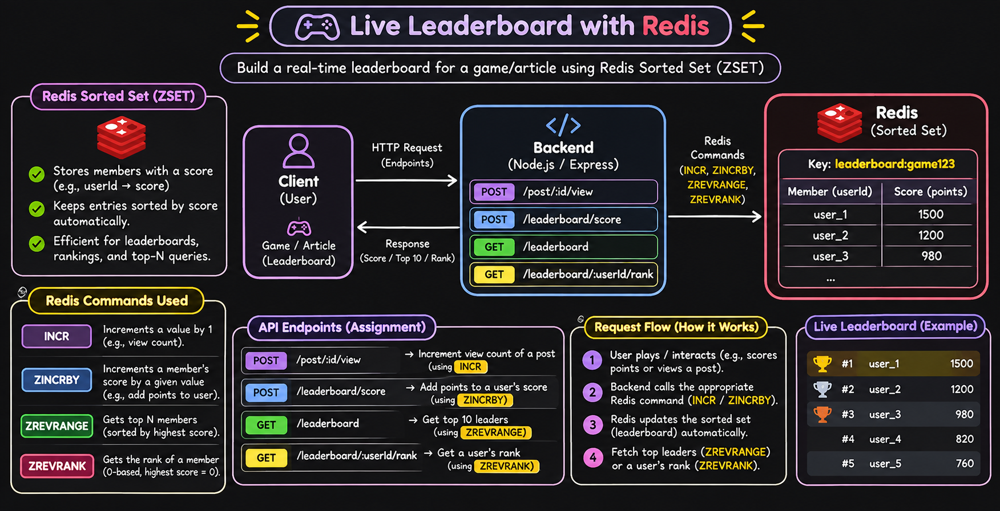

# 09 — Quiz Leaderboard and Counters with Redis



## 1. Overview

Build a real-time quiz leaderboard using **Redis Sorted Sets (ZSET)** and track post views using Redis counters.

Redis automatically maintains player rankings based on their scores, making leaderboard operations fast and efficient.

## 2. Redis Commands Used

| Command     | Purpose                              |
| ----------- | ------------------------------------ |
| `INCR`      | Increments a counter by 1            |
| `ZINCRBY`   | Increments a user's score            |
| `ZREVRANGE` | Fetches top members by highest score |
| `ZREVRANK`  | Gets a user's rank (0-based)         |

## 3. Redis Data Structure

**Leaderboard Key:** `leaderboard:game123`

| Member (User ID) | Score |
| ---------------- | ----: |
| sachin           |   150 |
| rahul            |   120 |
| ashwin           |    90 |

Redis Sorted Sets store unique members with scores and automatically maintain their sorted order.

**Post View Key:** `post:123:views`

Stores the total number of views for a particular post.

## 4. API Endpoints

| Method | Endpoint                    | Redis Command | Purpose              |
| ------ | --------------------------- | ------------- | -------------------- |
| POST   | `/post/:id/view`            | `INCR`        | Increment post views |
| POST   | `/leaderboard/score`        | `ZINCRBY`     | Add points to a user |
| GET    | `/leaderboard`              | `ZREVRANGE`   | Get top 10 players   |
| GET    | `/leaderboard/:userId/rank` | `ZREVRANK`    | Get a user's rank    |

### Example: Add Score

**POST** `/leaderboard/score`

Request body:

```json
{
  "userId": "sachin",
  "points": 50
}
```

Each request adds points to the user's existing score.

## 5. Run the Project

Make sure Docker Desktop and Redis are running.

```bash
docker compose up -d redis
npm install
npm run dev
```

Server: `http://localhost:3000`

Test the endpoints using Postman or Thunder Client.

## 6. Important Notes

- `INCR` starts from 1 if the counter key doesn't exist.
- `ZINCRBY` automatically updates an existing member's score.
- `ZREVRANGE` returns members from highest to lowest score.
- `ZREVRANK` uses zero-based ranking, so add `1` for normal leaderboard positions.
- Sorted Sets are useful for leaderboards, rankings, gaming scores, and top-N queries.

**Remember:** Redis Sorted Sets automatically maintain score-based ordering, eliminating the need to sort leaderboard data manually.
